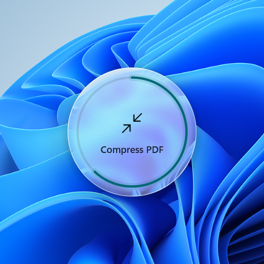
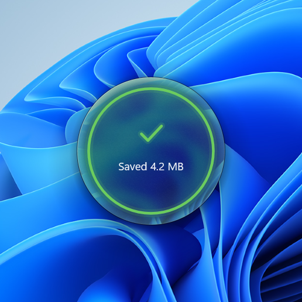
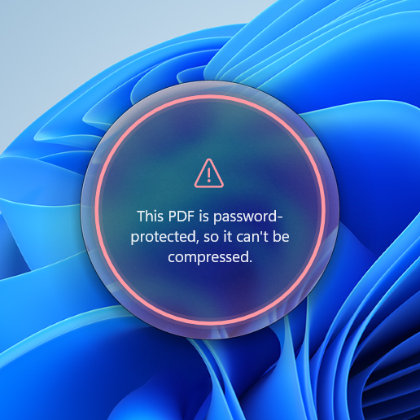
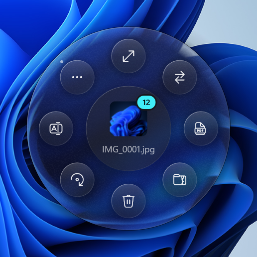
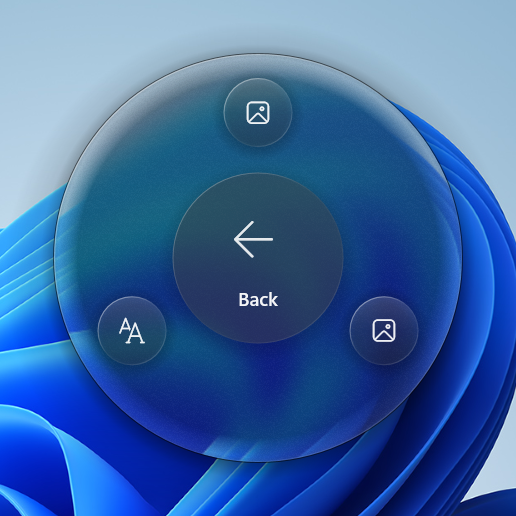

<div align="center">

<h1>⭕ Orbit</h1>

<h3>The fastest way to act on files.</h3>

<p>Select files in Explorer. Press <kbd>Alt</kbd> + <kbd>Q</kbd>. A glass ring blooms around your cursor.<br>Pick an action, and it's done, right on your PC. No websites, no uploads, no waiting.</p>


<p><a href="https://github.com/GalacticVraj/orbit/releases/latest/download/Orbit-Setup.exe"></a></p>

<p><sub><b>3.2 MB</b> &nbsp;·&nbsp; Windows 10 &amp; 11 &nbsp;·&nbsp; no admin rights &nbsp;·&nbsp; no account &nbsp;·&nbsp; never uploads a file &nbsp;·&nbsp; <a href="https://github.com/GalacticVraj/orbit/releases/latest/download/Orbit-portable.zip">portable zip</a></sub></p>

<p><a href="https://github.com/GalacticVraj/orbit/releases/latest"></a>    <a href="LICENSE"></a></p>

<br><br>

<h3>⚡ Everything you used to open a website for</h3>

</div>

| Select | And Orbit can |
|---|---|
| 📄 **PDF** | Compress · Split pages · Extract images · Convert to Word · Merge PDFs (2 or more) |
| 📝 **Word** | Convert to PDF · Extract images |
| 📊 **PowerPoint** | Convert to PDF · Export slides as PNG / JPG |
| 🖼️ **Images** | Convert to JPG / PNG / WEBP · Resize to 50% / 1920 / 1280 / 800 px · Compress |
| 🎬 **Videos** | Compress (H.264) · Convert to MP4 · Extract the audio |
| 📁 **Folders** | Zip · Calculate size |
| 🗂️ **Many files** | Every action as a batch · Zip · Calculate size · **Batch rename** |
| ✨ **Anything** | Smart Rename · Undo rename · your own plugins |

<div align="center">

<p><sub>Results land next to the original and never overwrite anything (<code>name (2).ext</code>). When it's done, Orbit selects the new file for you.</sub></p>

<br><br>

<p>&nbsp;&nbsp;&nbsp;</p>

<h3>💧 Liquid glass, not a menu</h3>

<p>The ring is a frosted lens over whatever is behind it, and its rim refracts the world just past the edge.<br>It wobbles when it opens, swells toward the action under your cursor and squishes when you press. Every motion is a spring.</p>

<br><br>

<p>&nbsp;&nbsp;&nbsp;&nbsp;</p>

<h3>✅ It tells you what happened</h3>

<p>Progress fills the rim. Success glows green with what you saved. And when something can't be done,<br>it says why in plain words instead of crashing or failing silently.</p>

<br><br>

<p>&nbsp;&nbsp;&nbsp;</p>

<h3>🗂️ One file or a hundred</h3>

<p>Select twelve photos and they all resize, convert or zip in one go.<br><b>Smart Rename</b> turns <code>IMG_1024.jpg</code> into <code>Vacation_001.jpg</code> with a live preview, and <b>Undo</b> is one click away.</p>

<br><br>

<h3>📥 Get it in 10 seconds</h3>

<p><a href="https://github.com/GalacticVraj/orbit/releases/latest/download/Orbit-Setup.exe"></a></p>

<p><b>1.</b> Run <code>Orbit-Setup.exe</code> and choose <b>Yes</b> &nbsp;&nbsp;→&nbsp;&nbsp; <b>2.</b> Select a file in Explorer &nbsp;&nbsp;→&nbsp;&nbsp; <b>3.</b> Press <kbd>Alt</kbd> + <kbd>Q</kbd></p>

<p><sub>"Windows protected your PC"? Click <b>More info → Run anyway</b>. SmartScreen is careful with new apps from independent developers; every line Orbit runs is in this repo.<br>It installs per-user (no admin rights), starts with Windows and lives in the tray. Prefer no install? Get the <a href="https://github.com/GalacticVraj/orbit/releases/latest/download/Orbit-portable.zip">portable zip</a>.</sub></p>

</div>

<br>

### Controls

| Do this | And |
|---|---|
| Select files, press <kbd>Alt</kbd> + <kbd>Q</kbd> | The ring opens around your cursor |
| Right-click → *Show more options* → **Orbit** | The same ring, from the context menu |
| Click, or <kbd>1</kbd>–<kbd>9</kbd> | Run an action |
| Mouse wheel, arrow keys or <kbd>Tab</kbd>, then <kbd>Enter</kbd> | Turn the dial and pick |
| Right-click, <kbd>Esc</kbd> or <kbd>Backspace</kbd> | Go back, or close |

### Private and light

- **Nothing leaves your PC.** No cloud, no account, no telemetry. Every conversion runs locally.
- **0% CPU at rest.** No timers, no polling, no file watching, no indexing. Orbit sleeps until you press <kbd>Alt</kbd> + <kbd>Q</kbd>.
- **Fast.** It's ready about 0.1 s after launch, and the ring appears 51–91 ms after the hotkey.
- **Tiny.** One 3.2 MB exe, about 15 MB of memory at rest.

### FAQ

<details>
<summary><b>Do I need Microsoft Office?</b></summary>
<br>
Only for Word and PowerPoint conversions (and PDF → Word). Orbit uses Office if it's installed, with LibreOffice as the fallback. Everything else (PDFs, images, videos, zips, renaming) works on its own.
</details>

<details>
<summary><b>Will it overwrite my files?</b></summary>
<br>
Never. Results are saved next to the original with a new name, like <code>report (2).pdf</code>. Renames can be undone from the ring.
</details>

<details>
<summary><b>How do I uninstall it?</b></summary>
<br>
<i>Settings → Apps → Orbit</i>. Your plugins and rename-undo history stay in <code>%APPDATA%\Orbit</code>; delete that folder to remove them too.
</details>

<details>
<summary><b>Windows blocks it completely. What now?</b></summary>
<br>
With <b>Smart App Control</b> turned on, Windows blocks unsigned apps, and Orbit isn't code-signed yet. Signed releases are first on the roadmap.
</details>

### Plugins

Add your own actions to the ring, in any language. A plugin is a folder with a `plugin.json` and an executable or script (`.exe`, `.ps1`, `.cmd`, `.py`). It runs in its own process and reports back through `progress:` / `message:` / `reveal:` lines. See [docs/PLUGINS.md](docs/PLUGINS.md) and try the example:

```powershell
orbit --install-plugin examples-plugins\checksum      # adds "Copy SHA-256" to the ring
```

Command-line flags: `--portable` (run without installing), `--install`, `--uninstall`, `--install-plugin <folder|zip>`, `--quit`, `--ring <paths…>`.

### Build it yourself

You need [rustup](https://rustup.rs) with the GNU host. No Visual Studio is required.

```powershell
rustup-init -y --default-host x86_64-pc-windows-gnu --profile minimal
.\build.ps1                      # debug build → target\debug\orbit.exe
.\build.ps1 -Release             # release build → dist\Orbit-Setup.exe + dist\Orbit-portable.zip
.\build.ps1 -Cargo test --workspace
.\build.ps1 -Cargo run -p orbit-ring --example demo        # live ring playground
.\build.ps1 -Cargo run -p orbit-ring --example snapshot    # render every ring state to target\snapshots
```

**Installer.** `Orbit-Setup.exe` is the release exe itself: run from anywhere, it offers to install, copies
itself, and registers autostart, the shortcut, the context menu and an Apps & Features entry. Everything is
per-user. Because the GNU toolchain has no `windres`, the exe carries no embedded icon. Shortcuts, Apps & Features
and the context menu use the `orbit.ico` written at install time, and the tray icon is drawn in code.

Two toolchain notes:
- `windows` is pinned to 0.58. It links through prebuilt import libraries, whereas 0.59+ uses raw-dylib, which
  needs binutils `as`, and that isn't shipped with the GNU toolchain.
- `.cargo/config.toml` switches `getrandom` to its `windows_legacy` backend for the same reason.

**Smart App Control:** with SAC on, Windows blocks unsigned binaries, including Orbit and every test build. To
ship to SAC-enabled PCs, sign the release with a publicly trusted certificate (e.g. Azure Trusted Signing).

<details>
<summary><b>How it's made</b></summary>
<br>

```
orbit/
├─ src/main.rs            Host: single instance, Alt+Q hotkey, tray, CLI, dispatch to worker threads
├─ crates/
│  ├─ core/               Shared types: Action, Outcome, Bitmap, Kind, safe output paths
│  ├─ shell/              Explorer: selection (incl. Win11 tabs and the desktop), thumbnails, reveal, context menu
│  ├─ ring/               The ring: layered window, D2D renderer, glass backdrop, springs, input, task states
│  ├─ engine/             Conversions: pdf.rs (lopdf) · img.rs (image) · office.rs (Word/PowerPoint COM)
│  │                      · video.rs (Media Foundation) · files.rs (zip, size, docx media)
│  ├─ rename/             Smart Rename: engine.rs (rules, two-phase apply, undo journal) · ui.rs (Mica window)
│  ├─ plugins/            Out-of-process plugins: manifest discovery, sandboxed launch, install from folder/zip
│  └─ setup/              Per-user install/uninstall, autostart, .ico + procedural logo
├─ examples-plugins/checksum/   Example plugin ("Copy SHA-256")
├─ docs/PLUGINS.md        Plugin format, protocol, trust model
├─ build.ps1              Build / package script
└─ .cargo/config.toml     GNU-toolchain linker workaround (see below)
```

**Event-driven, end to end.** At idle the host thread is blocked in `GetMessageW`. There are no timers, polling,
hooks, file watchers or indexing. Alt+Q comes in as `WM_HOTKEY`, and Orbit reads the selection from the
foreground Explorer over COM in about 3 ms. The ring renders frames only while a spring is moving (render →
`DwmFlush` → post the next frame), and goes back to sleep as soon as everything settles. Actions run on a worker
thread inside `catch_unwind`, so a bad file shows an error on the ring instead of crashing Orbit.

**Explorer right-click.** A per-user `HKCU\Software\Classes\{*,Directory}\shell\Orbit` verb starts
`orbit.exe --ring "%1"`. That process forwards its paths to the running instance through `WM_COPYDATA`, and the
host collects multi-select launches for 250 ms before opening a single ring.

**Plugins.** Each plugin is a folder holding a `plugin.json` plus any executable or script (`.exe`, `.ps1`,
`.cmd`, `.py`). Plugins run in their own process, so they can be written in any language, a crash can't take
Orbit down, and an uninstalled plugin costs nothing. Progress, messages and output files come back through
`progress:` / `message:` / `reveal:` lines on stdout. See [docs/PLUGINS.md](docs/PLUGINS.md). Install one with
`orbit --install-plugin examples-plugins\checksum`.

</details>

<details>
<summary><b>Performance report</b></summary>
<br>

All figures were measured on this machine with the release build (Windows 11 26340).

| Metric | Target | Measured |
|---|---|---|
| Idle CPU | 0% | **0 ms CPU over 10 s** (blocked in `GetMessageW`) |
| Idle RAM | < 50 MB | **0.1–4 MB working set, ≈15 MB private** |
| Startup (launch → ready) | < 300 ms | **59–120 ms** (first launch of a new build ≈330 ms while Defender scans it) |
| Alt+Q → ring visible | < 100 ms | **51–91 ms** warm; **≈135 ms** for the first open after launch |
| Compress a 1080p JPEG (end to end) | — | 224 ms from keypress to file on disk |
| Exe size | — | 3.2 MB (1.5 MB zipped) |

What makes it fast:
- **Native draw path.** The ring is a layered window drawn by Direct2D into a premultiplied DIB. It has no
  framework, no XAML and no web view.
- **Cheap glass.** The blur is a screen capture downsampled to ¼ size, run through three box-blur passes and
  given a saturation lift. A half-size sharp copy feeds the refracting rim. Both take about 3 ms per open
  instead of a GPU effect chain.
- **Glass baked once per show.** Frost, tint, refracting rim, edge glow, sheen and grain are drawn once into
  a bitmap, so each frame does one fill for the body. Gradient stop collections are cached, and animated alpha
  goes through brush opacity so the cache keeps hitting. A full menu frame costs 2–4 ms wall and 7–10 ms CPU
  at 150% scaling, down from 12–27 ms CPU.
- **About 60 FPS on any panel.** On 120–165 Hz displays the frame loop skips alternate vblanks instead of
  rendering two to three times as often. Frames run only while something moves, and the ring goes back to
  0% CPU once its springs settle.
- **Warm-up after launch.** Right after the message loop starts, Orbit does the one-time setup (window,
  D2D/DirectWrite, fonts, shell image factory) and then trims its working set. That cut the first ring open from
  232 to 135 ms.
- **Thumbnails from Explorer's cache.** The centre icon only reads thumbnails Explorer has already cached
  (`SIIGBF_INCACHEONLY`). If none exists it falls back to the file icon rather than decoding the image on the hotkey path.
- **Trimming after every close.** Per-show bitmaps are freed when the ring closes and
  `K32EmptyWorkingSet` hands the pages back.
- **Lazy plugins.** Plugin manifests are read when you press Alt+Q, never watched in the background.
- **Parallel PDF work.** PDF image recompression is parallelised with rayon, and unused-object pruning uses a
  linear graph walk instead of lopdf's O(n²) one.

Known limits:
- The first open after launch is ~35 ms over target. That time is DLL paging and the first cross-process
  Explorer call.
- About 15 thread-pool threads stay parked after the warm-up. They use no CPU. They belong to the software
  rasterizer, which spreads each frame across cores: during an animation CPU time is about 2–3× the wall time.

</details>

<details>
<summary><b>Why Rust + Direct2D</b></summary>
<br>

Score from 1 to 5 (higher is better):

| Stack | RAM | Startup | Native look | Animation | Win integration | Verdict |
|---|---|---|---|---|---|---|
| **Rust + Win32 + Direct2D/DirectWrite** | 5 (≈2 MB private idle) | 5 | 5 (we draw Fluent ourselves) | 5 (springs, vsync via DwmFlush) | 5 (direct COM) | **Chosen** |
| C++ Win32 | 5 | 5 | 5 | 5 | 5 | Same result, with less memory safety and slower iteration |
| WinUI 3 | 2 (60–100 MB) | 2 | 5 | 4 | 3 | Too heavy for a resident utility |
| WPF | 2 (50–80 MB) | 2 | 3 | 4 | 3 | Over the RAM budget; .NET JIT startup |
| Avalonia | 2 | 2 | 2 | 4 | 2 | Not native; heavy |
| Qt | 3 | 3 | 2 | 4 | 3 | Large runtime; not native-looking |
| Tauri | 2 (WebView2 ≈ 80 MB+) | 3 | 2 | 4 | 2 | A browser engine for a 400 px ring |
| Electron | 1 | 1 | 1 | 4 | 2 | Exactly what Orbit must not be |

</details>

<details>
<summary><b>Limitations and roadmap</b></summary>
<br>

- **Office.** Word/PDF/PowerPoint conversions need Microsoft Office, with LibreOffice as the fallback. The
  LibreOffice path has only been compiled, not run, because LibreOffice isn't installed here.
- **Video.** Video uses Windows Media Foundation, with ffmpeg as the fallback for formats it can't open. The
  ffmpeg path has only been compiled, not run.
- **Image formats.** WEBP output is lossless only, a limit of the `image` crate. Animated GIFs keep only their first frame.
- **Context menu.** On Windows 11 the Orbit entry sits under *Show more options*. See the roadmap.
- **No cancel.** A running action can't be cancelled yet; Esc only hides the ring while the action finishes.

**Roadmap**

1. **Signed releases.** Use Azure Trusted Signing so Orbit runs with Smart App Control on and SmartScreen stays quiet.
2. **Windows 11 top-level menu.** An `IExplorerCommand` handler in a sparse MSIX package would put "Orbit" in
   the modern right-click menu.
3. **Cancel and queue.** Let you cancel a running action, and queue several jobs with a compact progress pill.
4. **Settings.** Configurable hotkey, pinned and reordered actions, and default resize/quality values.
5. **Lossy WEBP and AVIF** output through an optional plugin, so the core stays small.
6. **Plugins.** OCR (Windows.Media.Ocr, offline), clipboard tools, background removal (local ONNX model) and
   image generation, all through the existing plugin protocol.
7. **Accessibility.** UI Automation for the ring, so screen readers announce nodes and results.
8. **Per-action icons in the ring centre**, e.g. a live page-count preview for PDFs.

</details>

<br>

<div align="center">

<h3>Stop uploading your files to random websites.</h3>

<p><a href="https://github.com/GalacticVraj/orbit/releases/latest/download/Orbit-Setup.exe"></a></p>

If Orbit saved you a trip to a converter site, <b>⭐ star the repo</b>. It's how other people find it.

<sub>Made with care by <a href="https://github.com/GalacticVraj">GalacticVraj</a> · <a href="LICENSE">MIT License</a></sub>

</div>
